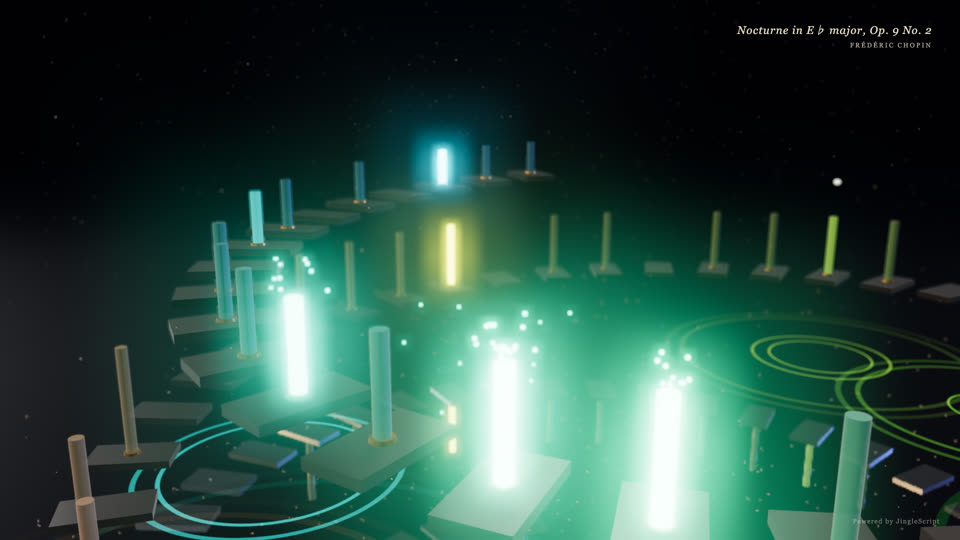
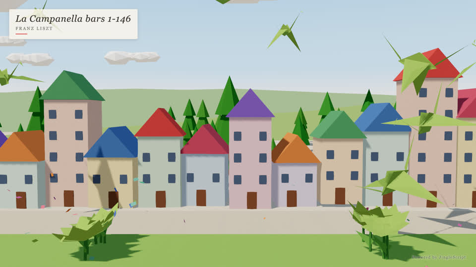

# JingleScript music video

Turn a JingleScript score into a 3D music video: the score is rendered to a WAV
plus `timing.json`, a deterministic Three.js scene draws any moment `t` on
request, headless Chrome captures it frame by frame, and ffmpeg muxes the MP4.

> **Design a new scene for every video.** The scenes in `scenes/` are only
> samples of the scene contract and of useful techniques. Don't reuse them
> as-is — if everyone renders the same scene, every video looks the same.
> Instead, the LLM proposes a few visual concepts for the piece, the user picks
> one, and the LLM writes a new `scenes/<name>/index.html` together with the
> user, using the samples only as references.

Two sample scenes, deliberately different:

| `crystal-stair`: night, glowing stair spiral over reflecting water | `paper-garden`: daylight origami town; cranes land and bloom into paper flowers |
| ------------------------------------------------------------------ | -------------------------------------------------------------------------------- |
|           |                                            |

## Requirements

- Node.js **>= 22.18** (the repo CLI and `prepare.ts` run TypeScript directly)
- Google Chrome or Chromium (driven by `puppeteer-core`; no browser download)
- ffmpeg

| OS      | Install                                                                                              |
| ------- | ---------------------------------------------------------------------------------------------------- |
| macOS   | `brew install node ffmpeg` and `brew install --cask google-chrome`                                   |
| Windows | `winget install OpenJS.NodeJS.LTS Gyan.FFmpeg Google.Chrome`                                         |
| Linux   | `sudo apt install ffmpeg chromium` (Node 22 via [nodesource](https://github.com/nodesource/distributions) or nvm) |

Chrome is found automatically in its standard install location; otherwise set
`CHROME_PATH=/path/to/chrome`.

## Setup

```sh
yarn install                         # repo root: the JingleScript CLI
cd tools/music-video && yarn install # three (pinned) + puppeteer-core
```

## Workflow: still → clip → full

First write your own scene (see [Designing a theme](#designing-a-theme)) and
pass it with `--scene <name>`; the commands below use the default example scene.
Always look at a still first, then a short clip, and only then render the
whole piece (a full render can take a long time).

```sh
cd tools/music-video
node render.mjs list                                              # pieces in examples/piano
node render.mjs still ../../examples/piano/nocturne-op9-2.json --t 30
node render.mjs clip  ../../examples/piano/nocturne-op9-2.json --t 30 --seconds 15
node render.mjs full  ../../examples/piano/nocturne-op9-2.json --cut 60
```

Output goes to `out/music-video/` at the repo root (git-ignored):
`still-<t>.png`, `clip-<t>s+<s>s.mp4`, `music-video.mp4`, and `data/`
(`score.json`, `music.wav`, `timing.json`, `notes.json`).

Stills need no audio: they only resolve the score (about a second). Clips and
full renders also render the audio (about 45 s for a 3.5-minute piece on an
M2 Max), once per score; later runs with the same score, `--cut` and `--instrument` reuse
`data/music.wav`. Use a separate `--out` per piece or instrument to keep them
cached side by side.

| Option                       | Meaning                                                                       |
| ---------------------------- | ----------------------------------------------------------------------------- |
| `--t <s>`                    | still time / clip start                                                       |
| `--seconds <s>`              | clip length (default 15)                                                      |
| `--cut <s>`                  | trim the score to its first `s` seconds, with a fade-out                      |
| `--instrument <name>`        | play every track on another instrument (see below)                            |
| `--w`, `--h`, `--fps`        | resolution and frame rate (default 1920×1080, 30)                             |
| `--cpu`                      | software rendering (SwiftShader) instead of the GPU                           |
| `--workers <n>`              | parallel capture browsers (frames are independent, so they split cleanly)     |
| `--scene <dir>`              | scene under `scenes/` (default `crystal-stair`)                               |
| `--cfg '<json>'`             | look parameters, e.g. `--cfg '{"exposure":2.2,"bloom":0.5}'`                  |
| `--title`, `--subtitle`      | override the on-screen title / composer                                       |
| `--out <dir>`                | output directory                                                              |

### Choosing a piece

Any `examples/piano/*.json` works (`node render.mjs list` prints file, length,
title and composer), as does your own score. The title and composer shown on
screen come from the score's `title`: a trailing `(Composer)` is moved to the
subtitle and expanded (e.g. `Liszt` → `Franz Liszt`); otherwise the composer is
looked up from the title. Use `--title`/`--subtitle` to override.

### Choosing an instrument

The scores play on `grandpiano`. `--instrument <name>` rewrites every track's
`instrument` before rendering. List the available instruments with:

```sh
node src/cli.ts instruments   # from the repo root
```

When swapping, pedals are dropped (only `grandpiano` has dampers) and notes
outside the instrument's range are moved by octaves into it.

## How the timing is used

`prepare.ts` runs JingleScript's own resolver (`expandScore`) on the score, so
notes placed by seconds, beats, cues or `end`, repeats, chords and strums all
come out exactly as they will sound. It writes to `data/`:

- `score.json`: the score as rendered (after `--cut` / `--instrument`)
- `timing.json`: the timing map (the same one `node src/cli.ts render` writes
  next to the WAV; for clips and full renders it is replaced by that one)
- `notes.json`: what scenes animate — one entry per sounding pitch (a chord
  gives one per note), sorted by `t`:
  `{ t, m, pitch, vel, len, track }`, where `m` is the MIDI number and `len` is
  how long the key is held (its `len`, or 0.5 s for notes left to ring).

`--cut` drops every note (and repeat) starting in the last 0.5 s before the cut
whatever its placement, clamps pedals, removes cues after the cut, and adds a
fade-out. Scenes compute everything analytically from `t`, so any frame can be
drawn in any order — that is what lets stills, clips and parallel workers agree.

## Designing a theme

The look is decided per video, in conversation: propose a few visual concepts
for the piece, pick one, write it as a scene, then iterate with stills, a short
clip, and finally the full render. Write a new `scenes/<name>/index.html`
for each video. The samples are only references for the contract and
techniques: `crystal-stair` (dark; bloom, reflections, depth of field,
note-synced physics) and `paper-garden` (bright; sun shadows, procedural paper
texture, instanced cranes/flowers/confetti, a title card that stays legible
on bright frames). Copy ideas from them, not the whole look.

### Scene contract

A scene is a directory `scenes/<name>/index.html`, served with:

- `/vendor/three/…` → the pinned `three` package (use an import map:
  `"three": "./vendor/three/build/three.module.js"`,
  `"three/addons/": "./vendor/three/examples/jsm/"`)
- `/data/…` → `timing.json` and `notes.json` (`{title, subtitle, notes:[{t, m, pitch, vel, len, track}]}`, sorted by `t`; see above)
- URL params:
  - `w`, `h`: output size in pixels (the page viewport is set to it; size the
    canvas from these, at device pixel ratio 1)
  - `fadeStart`, `fadeEnd`: a clip's start and end in seconds (fade picture in
    and out there; absent for full renders: fade in at 0 and out at the end)
  - `cfg`: JSON of look parameters to merge over the scene's defaults
  - `title`, `subtitle`: optional overrides of `notes.json`'s

It must:

1. Initialise from the data (`init(timing)`: fetch `data/timing.json` and
   `data/notes.json`, build everything, and wait for every texture, font and
   shader to be ready), then set `window.DURATION = timing.duration` and
   finally `window.ready = true`. Capture waits up to 120 s for `ready`;
   errors are printed as `[pageerror]`.
2. Expose `window.renderFrame(t)` that draws time `t` synchronously (the
   screenshot is taken right after it returns) and deterministically: no
   clocks or `requestAnimationFrame` loop, randomness only from a seeded
   generator, and nothing carried over from the previous frame (reset any
   shared scratch objects; disable frustum culling on instanced meshes whose
   instances move). Stills, clips and parallel workers then agree exactly.
3. Show the title/subtitle from `notes.json` and the small "Powered by
   JingleScript" credit.
   Size this text relative to `h` (the page is exactly `w`×`h` pixels, so
   fixed `px` sizes look tiny at 4K) and keep it legible on both bright and
   dark frames (a halo or shadow); nothing in the scene should cover it.
4. Fade the picture in at the start (or at `fadeStart`, quickly) and out
   towards `fadeEnd`; the title is shown in the first seconds and before the
   end of a full render, but not at the end of a clip.

Long pieces have thousands of notes: `notes` is sorted by `t`, so a frame
should only visit the notes near `t` (binary search) rather than all of them.
Use `scenes/crystal-stair/index.html` or `scenes/paper-garden/index.html` as a reference for all of this.

### Look parameters (`crystal-stair`)

| Key        | Default | Effect                           |
| ---------- | ------- | -------------------------------- |
| `exposure` | 1.8     | tone-mapping exposure            |
| `bloom`    | 0.7     | bloom strength                   |
| `bloomR`   | 0.55    | bloom radius                     |
| `bloomT`   | 0.62    | bloom threshold                  |
| `aperture` | 0.0002  | depth-of-field aperture          |
| `maxblur`  | 0.006   | depth-of-field maximum blur      |
| `fog`      | 0.02    | fog density                      |
| `env`      | 0.3     | environment-light intensity      |
| `glow`     | 4.5     | emissive intensity of lit notes  |

## GPU vs CPU

By default Chrome uses the GPU (Metal on macOS, D3D11 on Windows); the WebGL
renderer is printed at start. On an Apple M2 Max a 1080p frame takes about
0.05 s. `--cpu` uses SwiftShader, which works anywhere but is roughly 1 frame
per second at 1080p — add `--workers` to use more cores.

## Credit

Scenes show a subtle “Powered by JingleScript” in the bottom-right corner.
Please keep it.

## Examples

Videos made with this pipeline are published on the [MulmoMusic YouTube channel](https://www.youtube.com/@MulmoMusic).
